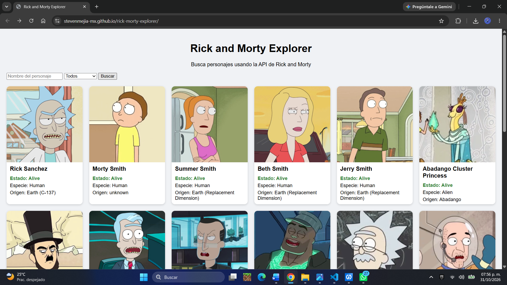
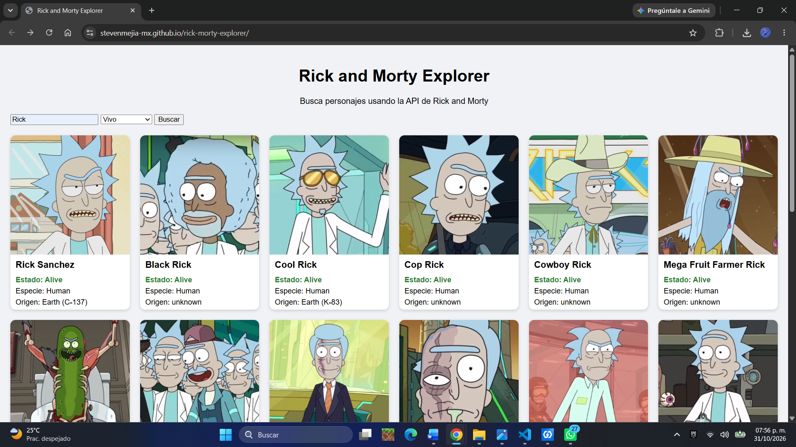
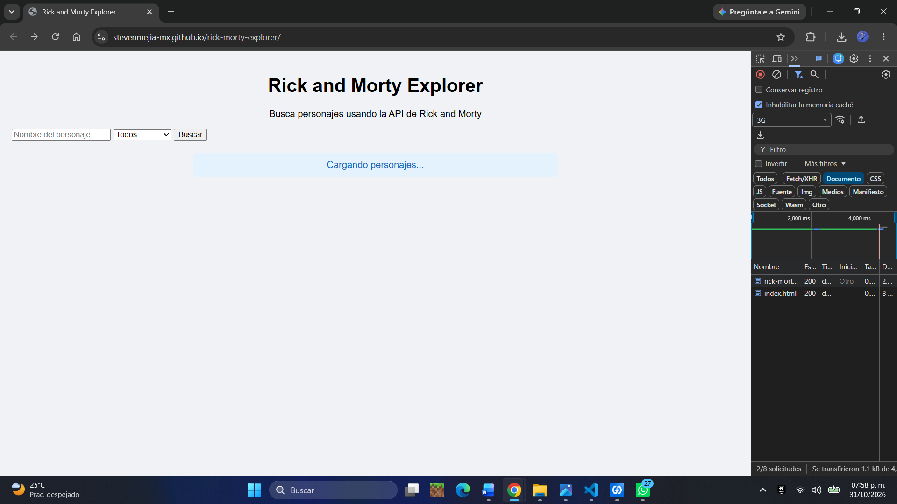
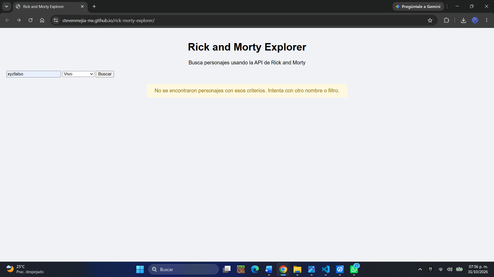
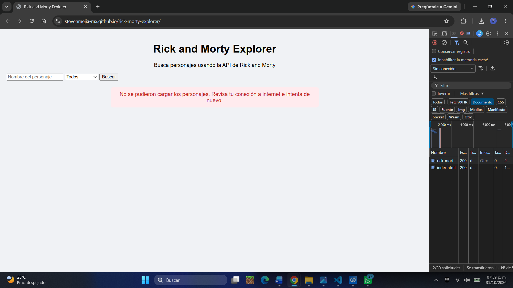
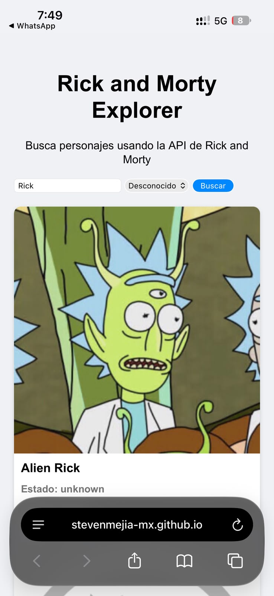

# Rick and Morty Explorer

Miniaplicación web que consume la [Rick and Morty API](https://rickandmortyapi.com) para buscar, filtrar y explorar personajes de la serie.

**Aplicación publicada:** https://stevenmejia-mx.github.io/rick-morty-explorer/

## API utilizada

La **Rick and Morty API** es una API REST pública y gratuita con información de los personajes, lugares y episodios de la serie. No requiere registro ni API key, y responde en formato JSON.

- Documentación: https://rickandmortyapi.com/documentation

## Endpoint utilizado

```
GET https://rickandmortyapi.com/api/character/
```

| Parámetro | Descripción | Ejemplo |
| --- | --- | --- |
| `name` | Filtra por nombre | `?name=rick` |
| `status` | Filtra por estado: `alive`, `dead` o `unknown` | `?status=alive` |
| `page` | Número de página (20 personajes por página) | `?page=2` |

Los parámetros se pueden combinar, por ejemplo: `?name=rick&status=alive&page=2`.

**Formato de respuesta:**

- `info`: total de resultados (`count`), total de páginas (`pages`) y URLs de la página siguiente (`next`) y anterior (`prev`).
- `results`: arreglo de personajes con `name`, `status`, `species`, `origin`, `image`, entre otros.

**Códigos de respuesta manejados:**

- `200`: búsqueda exitosa.
- `404`: no hay personajes que coincidan (`{"error": "There is nothing here"}`).
- Errores de red o del servidor: se muestra un mensaje de error al usuario.

## Funcionalidades

- Búsqueda de personajes por nombre.
- Filtro por estado (vivo, muerto, desconocido).
- Paginación con botones Anterior y Siguiente.
- Tarjetas creadas dinámicamente en el DOM con imagen, estado, especie y origen.
- Estados de carga, resultado vacío y error con mensajes comprensibles.
- Diseño adaptable a computadora y celular.

## Tecnologías

HTML5, CSS3, JavaScript ES6+ (Fetch API, async/await), JSON, Git, GitHub y GitHub Pages.

## Instrucciones de uso

**En línea:** abre la [aplicación publicada](https://stevenmejia-mx.github.io/rick-morty-explorer/).

1. Escribe un nombre en el buscador (por ejemplo, `rick`) o déjalo vacío.
2. Elige un estado en el menú, o deja "Todos".
3. Da clic en **Buscar** o presiona Enter.
4. Usa **Anterior** y **Siguiente** para navegar entre páginas.

**En local:**

1. Clona el repositorio:
   ```
   git clone https://github.com/StevenMejia-Mx/rick-morty-explorer.git
   ```
2. Abre la carpeta en VS Code y ejecuta `index.html` con la extensión Live Server.

## Estructura del proyecto

```
rick-morty-explorer/
├── index.html    → estructura de la página
├── styles.css    → estilos y diseño responsivo
├── app.js        → peticiones a la API y lógica de la interfaz
├── capturas/     → imágenes del README
└── README.md
```

El código de `app.js` está organizado en funciones con una sola responsabilidad cada una:

| Función | Responsabilidad |
| --- | --- |
| `obtenerPersonajes(url)` | Hace la petición con `fetch`, revisa el código de estado y decide qué estado mostrar |
| `construirURL()` | Arma la URL con los filtros del formulario usando `URLSearchParams` |
| `crearTarjeta(personaje)` | Construye la tarjeta de un personaje con `createElement` |
| `mostrarPersonajes(lista)` | Limpia el contenedor y agrega todas las tarjetas |
| `mostrarMensaje(texto, tipo)` | Muestra los mensajes de carga, vacío o error |
| `actualizarPaginacion(info)` | Habilita o deshabilita los botones según `info.next` e `info.prev` |

## Capturas

**Página principal**



**Búsqueda con filtro (Ricks vivos)**



**Estado de carga**



**Resultado vacío**



**Error de conexión**



**Vista en celular**



## Reflexión técnica

La primera API que elegí fue REST Countries, pero al consultar su documentación descubrí que la versión 3.1 había sido retirada: todas las peticiones devolvían un mensaje de *deprecated*. La versión nueva (v5) funciona, pero exige una API key. Como esta aplicación es solo frontend y se publica en un repositorio público, la clave habría quedado visible para cualquiera en el código o en las herramientas del navegador. Por eso cambié a la Rick and Morty API, que no requiere autenticación. Esta situación me enseñó que las APIs externas cambian, que hay que revisar su documentación actual y que las credenciales no deben exponerse en el frontend.

En lo técnico, lo más importante que aprendí fue el manejo de código asíncrono con `async/await` y que `fetch` no lanza un error cuando el servidor responde 404: hay que revisar `respuesta.ok` y `respuesta.status` manualmente. También entendí el alcance (*scope*) de las variables declaradas con `const` dentro de un bloque `try`, a leer los mensajes de error y la pila de llamadas en la consola, y a distinguir mis errores de los generados por extensiones del navegador. Como mejoras futuras, me gustaría traducir los estados de los personajes al español, mostrar una vista de detalle con los episodios de cada personaje y permitir guardar favoritos.
